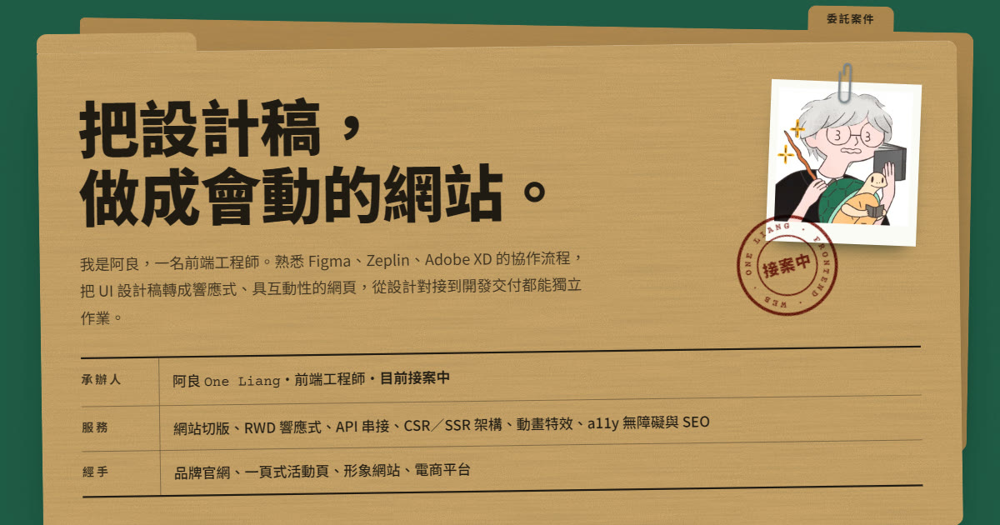

# 阿良 One Liang｜接案作品集

**👉 線上 Demo**

- 主站：[https://one-liang.github.io/liang/](https://one-liang.github.io/liang/)
- 同步站：[https://sololiang923.github.io/liang/](https://sololiang923.github.io/liang/)（[sololiang923/liang](https://github.com/sololiang923/liang)，與主站同一份程式碼）

前端工程師阿良的一頁式接案作品集：把設計稿做成能上線、會互動的網站。頁面以「接案卷宗」為設計語言（壓板綠桌面、牛皮紙卷宗、打字欄位、朱紅印章），整理 8 件真實上線作品、服務項目與聯絡方式，方便直接給客戶看。



## 作品 Demo

| No. | 作品 | 類型 | 連結 |
|---|---|---|---|
| 01 | 香奈兒腕錶形象頁 | 一頁式 | [one-liang.github.io/iWatcHome](https://one-liang.github.io/iWatcHome/)（原站已下線，備份版） |
| 02 | 食農知味 | 形象網站 | [one-liang.github.io/farmerstation](https://one-liang.github.io/farmerstation/)（原站已下線，備份版） |
| 03 | Mook | 一頁式 | [mook.com.tw](https://www.mook.com.tw/) |
| 04 | 景點+ | 部落格 | [mook.com.tw/travelplus](https://www.mook.com.tw/travelplus) |
| 05 | 全國電子 | 電商網站 | [ec.elifemall.com.tw](https://ec.elifemall.com.tw/) |
| 06 | 橘焱胡同 | 電商網站 | [gyenshop.com.tw](https://www.gyenshop.com.tw/) |
| 07 | 鏡好聽 | 形象網站 | [mirrorvoice.com.tw](https://www.mirrorvoice.com.tw/) |
| 08 | 鏡文學 | 形象網站 | [mirrorfiction.com](https://www.mirrorfiction.com/) |

聯絡：[sololiang923@gmail.com](mailto:sololiang923@gmail.com)

## 功能

- **一頁式**：開場卷宗 → 作品卷宗 → 服務委託單 → 關於 → 聯絡，頂部索引標籤可直接跳轉
- **作品篩選**：依「一頁式／形象網站／電商網站／部落格」篩選，GSAP Flip 重排
- **服務委託單**：勾選需要的服務，按下就開好一封整理過的 Email，也能一鍵複製內容
- **暗黑模式**：預設淺色，頁首可切換並記住選擇
- **無障礙**：鍵盤可操作、可見焦點、跳至主要內容、live region 通知、尊重「減少動態」設定，色彩對比符合 WCAG AA
- **SEO**：內容在建置時輸出為靜態 HTML，含 Open Graph 分享圖與 JSON-LD

## 技術

- [Vite 8](https://vite.dev/) — 開發與建置，自訂外掛在建置時把內容渲染進 `index.html`
- [TypeScript](https://www.typescriptlang.org/) — 所有互動腳本與內容資料
- [GSAP](https://gsap.com/)（ScrollTrigger、Flip、DrawSVG）— 卷宗落桌、截圖滑出、蓋章、手寫引線描出
- [Tailwind CSS 4](https://tailwindcss.com/) — 設計 token（`@theme`）、暗黑模式變體與元件樣式

## 開發

需要 Node.js 20.19 以上（建議 24）。

```bash
npm install
```

```bash
npm run dev
```

開發伺服器在 http://localhost:5173/liang/

```bash
npm run build
```

會先做型別檢查，輸出到 `dist/`；`npm run preview` 可預覽建置結果。

## 專案結構

```
index.html               頁面骨架；<!--slot:…--> 在建置時換成內容
vite.config.ts           base 路徑 /liang/ 與內容注入外掛
src/
  data/content.ts        所有文字內容：作品、服務、技能、聯絡 Email（要改內容改這裡）
  data/render.ts         把內容渲染成 HTML
  data/icons.ts          自繪 SVG 圖示
  scripts/               主題切換、導覽、篩選、委託單、複製、GSAP 動態
  styles/main.css        色票、材質與所有元件樣式
public/images/           頭像與作品截圖（WebP，720／1440 兩種寬度）
PRODUCT.md               產品定位與內容來源（/impeccable init 產出）
CHECKLIST.md             進度確認清單
```

### 更新作品

1. 截圖放到 `public/images/works/`，檔名 `<代號>-720.webp`、`<代號>-1440.webp`（寬 2:1）
2. 在 `src/data/content.ts` 的 `WORKS` 加一筆資料
3. `npm run build` 確認沒問題後依 Git Flow 發佈

## 部署

推到 `master` 時，GitHub Actions（`.github/workflows/deploy.yml`）會型別檢查、建置，並用官方的 `actions/deploy-pages` 發佈。兩個 repo 各自跑同一個 workflow：

| Repo | Pages 網址 |
|---|---|
| [one-liang/liang](https://github.com/one-liang/liang)（origin） | https://one-liang.github.io/liang/ |
| [sololiang923/liang](https://github.com/sololiang923/liang)（remote：`sololiang`） | https://sololiang923.github.io/liang/ |

- 網址由 workflow 依 repo 擁有者設定 `VITE_SITE_URL`（og:url、分享圖、結構化資料）；`canonical` 固定指向主站，避免兩站被當成重複內容。本機預設值在 `.env`。
- 每個 repo 第一次使用前，到 **Settings → Pages → Source** 選 **GitHub Actions**；預設分支要是 `master`。
- 如果部署出現「Branch "master" is not allowed to deploy to github-pages」，到 **Settings → Environments → github-pages → Deployment branches and tags** 加入 `master` 規則（需要擁有者權限），再重跑失敗的 workflow。

### 同步推送到兩個 repo

每次依 Git Flow 推送時，兩個 remote 都要推：

```bash
git push origin master develop --tags
```

```bash
git push sololiang master develop --tags
```

推到 sololiang923/liang 需要該帳號的權限：用 `gh auth login` 加入 sololiang923 帳號（gh 支援多帳號），或在 sololiang923/liang 把 one-liang 加為 collaborator。

## 分支與提交規範（Git Flow）

- 新功能：從 `develop` 開 `feature/<名稱>`；修 bug：`bugfix/<名稱>`；緊急修正：從 `master` 開 `hotfix/<名稱>`
- 完成後 `git merge --no-ff` 合回 `develop`，刪除分支再推送；發佈走 `release/<版本>` 合進 `master` 與 `develop`
- commit 訊息：`<類型>: <繁體中文說明>`，類型為 `feat`、`fix`、`docs`、`style`、`refactor`、`test`、`chore`

## 備份

改版前的 Vue 3 版本完整備份在私人 repo [one-liang/liang-backup](https://github.com/one-liang/liang-backup)。
